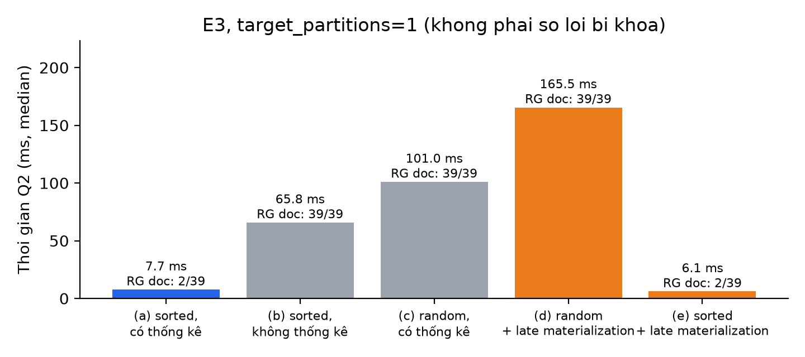
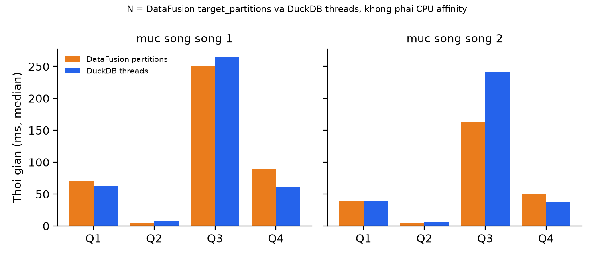

# Team 9 – Cài đặt minh họa Apache Arrow DataFusion

Đồ án môn **Hệ Cơ Sở Dữ Liệu Tiên Tiến (IS6002)**, Trường Đại học Công nghệ Thông tin.

Nhóm 9 dùng Python binding của DataFusion để kiểm chứng, ở quy mô nhỏ, các ý trong bài:

> Lamb, A. et al. (2024). *Apache Arrow DataFusion: A Fast, Embeddable, Modular Analytic Query Engine*. SIGMOD-Companion '24. https://doi.org/10.1145/3626246.3653368

Ba việc chính, tương ứng mục 6, 7 và 8 của bài báo:

- Đọc Parquet có projection pushdown, predicate pushdown và row-group / page pruning khi cột điều kiện được sắp.
- Gọi scalar UDF nhận và trả Arrow Array, so với `CASE WHEN` và với vòng lặp Python.
- So thời gian với DuckDB trên cùng dữ liệu. Mức song song N là `target_partitions=N` của DataFusion và `threads=N` của DuckDB. Đây không phải CPU affinity và không khóa máy về N lõi.

Thư viện đã ghim: DataFusion 55.0.0, DuckDB 2.0.0, PyArrow 26.0.1, pandas 3.0.5, NumPy 2.5.4, Matplotlib 3.11.2.

Tên repository đã chốt: `UIT-IS6002-Team9-DataFusion`. Chưa có GitHub owner trong bản này, nên README không điền URL. Sau khi tạo repo, điền URL vào báo cáo môn học.

## Cài trên Windows 11 (PowerShell)

Dùng `uv` và Python 3.13. Không dùng stub `WindowsApps`.

```powershell
cd <thu-muc-repo>
uv venv .venv --python 3.13.13
uv pip install --python .\.venv\Scripts\python.exe -r requirements.txt
```

Lệnh cài này đã chạy được trên máy kiểm chứng. Không dùng `python` của WindowsApps.

Các lệnh bên dưới gọi `.\.venv\Scripts\python.exe`. File văn bản (JSON, CSV, EXPLAIN) được ghi UTF-8 trong mã. Không cần đặt `PYTHONUTF8` để tránh lỗi ghi file.

## Chạy nhanh (dữ liệu nhỏ)

```powershell
.\.venv\Scripts\python.exe -m unittest discover -s tests -v
.\.venv\Scripts\python.exe src\gen_data.py --rows 100000 --row-group-size 8192 --seed 42 --out data-small
.\.venv\Scripts\python.exe src\run_experiments.py --data data-small --out results-small --runs 3 --parallelism 1 2 --seed 42
.\.venv\Scripts\python.exe src\make_charts.py results-small
```

Số mili giây của lần 100.000 dòng không dùng để đối chiếu báo cáo.

## Tái lập bộ 5 triệu dòng

Bộ `results/` đã commit là một lần chạy trên Windows 11, 12 luồng logic, mức song song 1 và 2, seed 42, 1 lần warm-up rồi 7 mẫu. Lệnh tái lập ghi ra thư mục khác để không đè bộ mẫu:

```powershell
.\run_all.ps1 -Rows 5000000 -Runs 7 -Parallelism 1,2 -Data data -Out results-rerun
```

Hoặc từng bước:

```powershell
.\.venv\Scripts\python.exe src\gen_data.py --rows 5000000 --seed 42 --out data
.\.venv\Scripts\python.exe src\run_experiments.py --data data --out results-rerun --runs 7 --parallelism 1 2 --seed 42
.\.venv\Scripts\python.exe src\make_charts.py results-rerun
```

`run_all.sh` làm cùng việc và ghi vào `results-rerun`. Phiên kiểm chứng này chạy trên Windows, không chạy lại script bash trên Linux.

`--runs` áp dụng cho mọi phương pháp, kể cả UDF vòng lặp. `--parallelism` nhận các số nguyên dương, bỏ trùng. Bỏ qua tham số này thì chương trình chọn 1 và 2 khi máy có ít nhất 2 luồng logic, và ghi số luồng logic thực vào `results.json`.

## Đầu ra

| Đường dẫn | Nội dung |
|---|---|
| `results/results.json` | Provenance, E1–E5, median và mẫu thô |
| `results/result_Q1.csv` … `result_Q5.csv` | Kết quả DataFusion |
| `results/explain_Q2.txt` | Plan logic và vật lý |
| `results/explain_analyze_Q2_*.txt` | Metric thực thi, không dùng làm median |
| `results/fig_e3_pruning.png` | Q2, một partition |
| `results/fig_e5_vs_duckdb.png` | Q1–Q4 ở mức song song 1 và 2 |

`data/` nằm trong `.gitignore`. Muốn giữ bộ mẫu thì không trỏ `--out` vào `results/`.

## Bộ mẫu hiện tại

Máy đo: Windows 11, AMD64, 6 nhân / 12 luồng logic, khoảng 16,8 GB RAM. Không phải máy ảo 2 vCPU. Dữ liệu nằm trong vùng warm-cache sau một lần khởi động. Một lần đo trên một máy.





Nhãn “mức song song N” nghĩa là DataFusion `target_partitions` và DuckDB `threads`. Hai chuỗi trong hình E5 là “DataFusion partitions” và “DuckDB threads”.

Trên file sorted, cả hai engine đều có thể bỏ row group ở Q2. Khoảng cách thời gian Q2 không được giải thích bằng việc chỉ DataFusion có pruning. File random có `bytes_scanned` và độ nén cột `order_date` khác file sorted không thống kê. `bytes_scanned` là chỉ số engine báo trong `EXPLAIN ANALYZE`, không phải số byte vật lý đọc từ đĩa. Chiều nhanh/chậm giữa hai engine phụ thuộc truy vấn và mức song song của lần đo này.

Chi tiết câu cần sửa trong báo cáo PDF nằm ở `REPORT_UPDATE_NOTES.md`. PDF trong `docs/` không nằm trong repository này.

## Giới hạn

- So sánh là minh họa, không tái lập ClickBench hay TPC-H của bài báo.
- UDF viết bằng Python. Câu hiệu năng ngang built-in trong bài báo nói về extension trong engine.
- Chưa có file `LICENSE`. Chọn giấy phép là việc của nhóm, không chặn chạy demo.
- Commit `70bd3e8` không mô tả cây mã đã sửa. Provenance trong `results/results.json` ghi `git_head_describes_measured_source: false` và hash SHA-256 của các file nguồn lúc đo.
