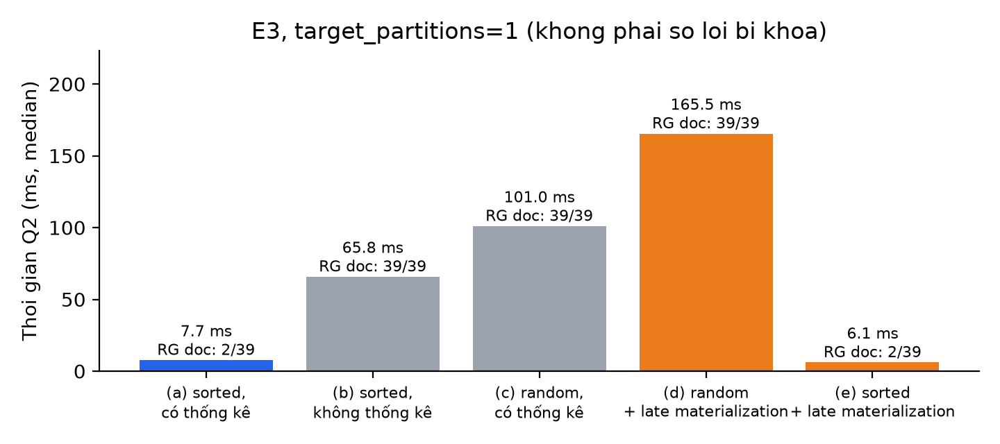
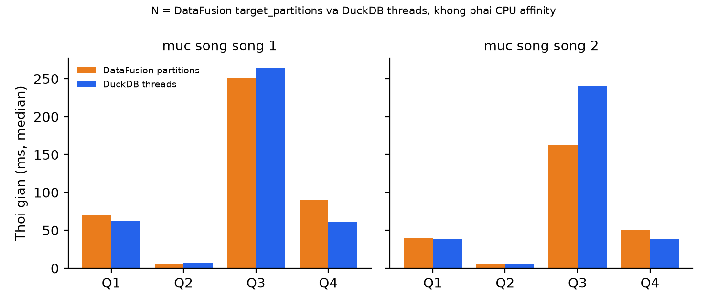

# Hướng dẫn đối chiếu và cập nhật số liệu cho Báo cáo môn học

Tài liệu này tổng hợp các bảng số liệu và nội dung nhận xét đề xuất để cập nhật vào báo cáo môn học **Hệ Cơ Sở Dữ Liệu Tiên Tiến (IS6002)**, giúp đồng bộ hoàn toàn giữa văn bản báo cáo và bộ kết quả thực nghiệm lưu tại [`results/results.json`](results/results.json) (thời điểm đo: `2026-11-09T15:49:45+07:00`).

---

## 1. Thông tin môi trường và thiết lập thực nghiệm cần cập nhật

Trong phần mô tả môi trường thực nghiệm của báo cáo, cần thay thế cấu hình máy ảo Linux 2 vCPU của bản nháp ban đầu bằng thông số của bộ kết quả chuẩn trên Windows 11:

- **Hệ điều hành và phần cứng:** Windows 11 (`10.0.26300`, kiến trúc `AMD64`), bộ xử lý 6 nhân / 12 luồng xử lý logic (`logical_processors = 12`), dung lượng RAM khoảng 16,83 GB (`16.833.388.544 bytes`).
- **Phiên bản phần mềm:** Python `3.13.13`, DataFusion `55.0.0`, DuckDB `2.0.0`, PyArrow `26.0.1`, pandas `3.0.5`, NumPy `2.5.4`, Matplotlib `3.11.2`.
- **Quy mô dữ liệu và quy trình lấy mẫu:**
  - Dữ liệu bán hàng giả lập gồm `5.000.000` dòng (`seed = 42`, hạt giống xáo trộn `shuffle_seed = 7`), chia thành `39` row group (mỗi row group tối đa `131.072` dòng, nén Snappy).
  - Mọi phép đo thời gian đều thực hiện **1 lần chạy làm nóng (*warm-up*)**, sau đó đo **7 lần liên tiếp (`--runs 7`)** và lấy giá trị **trung vị (*median*)**. Quy trình 1 lần warm-up + 7 mẫu đo được áp dụng đồng nhất cho tất cả các phương pháp, bao gồm cả biến thể Python UDF dùng vòng lặp từng dòng ở thí nghiệm `E4`.
  - Hai mức độ song song được khảo sát là `1` và `2`, tương ứng với tham số `target_partitions` của DataFusion và `threads` của DuckDB (cấu hình ở cấp độ engine, không khóa cứng CPU affinity của hệ điều hành).

---

## 2. Số liệu và nội dung phân tích theo từng thí nghiệm

### 2.1. Thí nghiệm E1 và E2 (Tính đúng đắn và Kế hoạch truy vấn)

- **Kết quả E1:** Toàn bộ 5 truy vấn `Q1`–`Q5` khi chạy trên DataFusion đều trả về kết quả khớp hoàn toàn (`vs_pandas = true`, `vs_duckdb = true`) với hai chuẩn tham chiếu độc lập là `pandas` và `DuckDB`. Các cột số nguyên và chuỗi khớp tuyệt đối; các cột số thực thỏa mãn đồng thời ngưỡng sai số tương đối `rtol = 1e-9` và sai số tuyệt đối `atol = 1e-6`.
- **Kết quả E2:** Kế hoạch truy vấn của `Q2` (lưu tại [`results/explain_Q2.txt`](results/explain_Q2.txt)) thể hiện rõ hai cơ chế tối ưu hóa ở toán tử `DataSourceExec`:
  - *Projection pushdown:* Chỉ đọc 3 cột `projection=[category, order_date, amount]` trong tổng số 9 cột của bảng.
  - *Predicate pushdown & Pruning predicate:* Đẩy điều kiện lọc ngày xuống tầng đọc Parquet dưới dạng `predicate` và biên dịch thành biểu thức cắt tỉa `pruning_predicate` dựa trên `order_date_min`, `order_date_max` và `order_date_null_count`.

### 2.2. Thí nghiệm E3 – Cắt tỉa dữ liệu Parquet trên truy vấn Q2 (`target_partitions = 1`)

Thay thế bảng số liệu và biểu đồ `E3` trong báo cáo bằng hình [`results/fig_e3_pruning.png`](results/fig_e3_pruning.png) và bảng sau:

| Cấu hình thí nghiệm | Thời gian trung vị (ms) | Row group đọc / tổng | Trang đọc / tổng (Page Index) | Chỉ số `bytes_scanned` | Số dòng ra khỏi tầng quét |
|---|---:|---:|---:|---:|---:|
| **(a) sorted, có thống kê** | 7,666 | 2 / 39 | 8 / 14 | 934,7 K | 151,1 K |
| **(b) sorted, không thống kê** | 65,786 | 39 / 39 | 0 / 0 | 22,76 M | 5,00 M |
| **(c) random, có thống kê** | 101,003 | 39 / 39 | 267 / 267 | 29,81 M | 5,00 M |
| **(d) random + late materialization** | 165,477 | 39 / 39 | 267 / 267 | 29,81 M | 141,2 K |
| **(e) sorted + late materialization** | 6,073 | 2 / 39 | 8 / 14 | 934,7 K | 141,2 K |

**Nội dung giải thích đề xuất cho báo cáo:**
- Khi dữ liệu được sắp xếp theo `order_date` và file Parquet lưu đầy đủ thống kê ở cấu hình `(a)`, DataFusion sử dụng `min/max` của từng row group để bỏ qua 37/39 row group, chỉ giữ lại 2 row group có giao với tháng 3/2025. Tiếp đó, nhờ chỉ mục trang (*page index*), engine tiếp tục loại thêm 6/14 trang dữ liệu, chỉ đọc 8 trang (`934,7 KB` theo chỉ số `bytes_scanned`) với thời gian trung vị `7,666 ms`. Khi kết hợp thêm tùy chọn *late materialization* (`pushdown_filters = true`) ở cấu hình `(e)`, bộ lọc được áp dụng ngay trong lúc giải mã Parquet để loại bỏ thêm `9,88 K` dòng ở ranh giới trang, giúp thời gian giảm nhẹ xuống `6,073 ms`.
- Ngược lại, nếu tắt thống kê `min/max` ở cấu hình `(b)`, hoặc nếu dữ liệu bị xáo trộn ngẫu nhiên ở cấu hình `(c)`, engine buộc phải quét cả `39/39` row group. Thời gian trung vị tăng lên `65,786 ms` ở `(b)` và `101,003 ms` ở `(c)`.
- Giữa `(b)` và `(c)`, file xáo trộn `(c)` mất nhiều thời gian hơn đi kèm với lượng `bytes_scanned` lớn hơn (`29,81 MB` so với `22,76 MB`) và số trang nhiều hơn do cột `order_date` khi xáo trộn ngẫu nhiên có độ nén kém hơn so với khi các ngày giống nhau nằm liên tiếp. Cần lưu ý rằng `bytes_scanned` là chỉ số do toán tử quét của DataFusion báo cáo trong `EXPLAIN ANALYZE` và các mẫu đo được thu thập sau bước warm-up (dữ liệu có thể nằm trong OS cache), nên không quy kết toàn bộ độ chênh thời gian này cho tốc độ đọc đĩa vật lý.
- Ở cấu hình `(d)`, việc bật `pushdown_filters = true` trên dữ liệu xáo trộn giúp giảm số dòng đi ra khỏi toán tử `DataSourceExec` từ `5,00 M` xuống `141,2 K` (loại bỏ `4,86 M` dòng), nhưng do các bản ghi tháng 3/2025 nằm rải rác ở mọi trang (`267/267` trang), chi phí đánh giá bộ lọc và giải mã theo trang trên toàn bộ bảng làm tổng thời gian tăng lên `165,477 ms`.

### 2.3. Thí nghiệm E4 – Hàm tự định nghĩa Python UDF so với `CASE WHEN` trên truy vấn Q5

Thay thế bảng số liệu `E4` trong báo cáo bằng bảng sau (trung vị của 7 lần đo sau 1 lần warm-up):

| Phương pháp cài đặt Q5 | Trung vị ở `target_partitions = 1` (ms) | Trung vị ở `target_partitions = 2` (ms) | Tỷ lệ so với `CASE WHEN` (mức 1) | Tỷ lệ so với `CASE WHEN` (mức 2) |
|---|---:|---:|---:|---:|
| **Biểu thức tích hợp (`Built-in CASE WHEN`)** | 318,860 | 128,072 | 1,00× | 1,00× |
| **Python UDF vector hóa (`Arrow vectorized`)** | 312,971 | 191,219 | 0,98× | 1,49× |
| **Python UDF vòng lặp (`row-by-row loop`)** | 869,223 | 755,080 | 2,73× | 5,90× |

*(Tỷ lệ ở mức `target_partitions = 2` được tính trực tiếp từ trung vị chưa làm tròn trong `results.json`: `191,2185 / 128,0716 ≈ 1,493` và `755,0796 / 128,0716 ≈ 5,896`).*

**Nội dung giải thích đề xuất cho báo cáo:**
- Kết quả cho thấy sự khác biệt rõ rệt giữa hai cách viết Python UDF: hàm `order_tier_arrow` xử lý theo lô cột bằng `pyarrow.compute` chỉ mất `312,971 ms` (ở 1 partition) và `191,219 ms` (ở 2 partitions), nhanh hơn gấp khoảng `2,8 lần` đến `3,9 lần` so với hàm `order_tier_rowwise` duyệt từng phần tử bằng vòng lặp Python (`869,223 ms` và `755,080 ms`).
- Khi chạy với `target_partitions = 1`, thời gian thực thi của UDF Arrow (`312,971 ms`) và biểu thức `CASE WHEN` tích hợp (`318,860 ms`) xấp xỉ nhau trên lần đo này. Khi tăng lên `target_partitions = 2`, biểu thức `CASE WHEN` thực thi hoàn toàn trong nhân Rust giảm mạnh xuống `128,072 ms`, trong khi UDF Arrow giảm xuống `191,219 ms` (chậm hơn `CASE WHEN` khoảng `1,49 lần`).
- Khi liên hệ với Mục 7.1 của bài báo gốc, cần nêu rõ rằng nhận định *"cơ chế mở rộng đạt hiệu năng tương đương hàm tích hợp"* trong bài báo nói về các hàm mở rộng viết bằng Rust bên trong engine. Đối với Python UDF trong bản minh họa này, dù đã vector hóa trên mảng Arrow, quá trình thực thi vẫn phải chuyển ngữ cảnh qua lại giữa các luồng Rust và trình thông dịch Python.

### 2.4. Thí nghiệm E5 – So sánh thời gian thực thi với DuckDB trên Q1–Q4

Thay thế bảng số liệu và biểu đồ `E5` trong báo cáo bằng hình [`results/fig_e5_vs_duckdb.png`](results/fig_e5_vs_duckdb.png) và bảng dưới đây (tỷ lệ `DF / DuckDB` lấy từ trường `ratio_df_over_duck`, tính trên số giây trung vị chưa làm tròn):

| Truy vấn | DataFusion — mức 1 (s) | DuckDB — mức 1 (s) | Tỷ lệ DF/Duck (mức 1) | DataFusion — mức 2 (s) | DuckDB — mức 2 (s) | Tỷ lệ DF/Duck (mức 2) |
|---|---:|---:|---:|---:|---:|---:|
| **Q1** | 0,07036 (70,4 ms) | 0,06292 (62,9 ms) | 1,118 | 0,03927 (39,3 ms) | 0,03883 (38,8 ms) | 1,011 |
| **Q2** | 0,00485 (4,9 ms) | 0,00736 (7,4 ms) | 0,660 | 0,00478 (4,8 ms) | 0,00618 (6,2 ms) | 0,773 |
| **Q3** | 0,25075 (250,8 ms) | 0,26428 (264,3 ms) | 0,949 | 0,16259 (162,6 ms) | 0,24113 (241,1 ms) | 0,674 |
| **Q4** | 0,08985 (89,8 ms) | 0,06128 (61,3 ms) | 1,466 | 0,05084 (50,8 ms) | 0,03853 (38,5 ms) | 1,320 |

**Nội dung giải thích đề xuất cho báo cáo:**
- **Hiệu quả mở rộng theo mức song song:** Khi tăng mức song song từ `1` lên `2` (`target_partitions` từ 1 lên 2), thời gian chạy của DataFusion giảm khoảng `1,79 lần` ở `Q1` (`0,07036 s` xuống `0,03927 s`), `1,54 lần` ở `Q3` (`0,25075 s` xuống `0,16259 s`) và `1,77 lần` ở `Q4` (`0,08985 s` xuống `0,05084 s`). Truy vấn `Q2` chỉ xử lý 2 row group với thời gian dưới `5 ms` nên hầu như giữ nguyên giữa hai mức.
- **So sánh tương quan giữa DataFusion và DuckDB:** Không có một engine nào nhanh hơn tuyệt đối trên mọi truy vấn. Trên bộ kết quả này, DataFusion đạt thời gian trung vị thấp hơn ở `Q2` (tỷ lệ `0,660` và `0,773`) và `Q3` (tỷ lệ `0,949` ở mức 1 và `0,674` ở mức 2), trong khi DuckDB nhanh hơn ở `Q4` (tỷ lệ `1,466` và `1,320`) và nhỉnh hơn nhẹ ở `Q1` mức 1 (`1,118`, còn ở mức 2 hai engine xấp xỉ nhau với tỷ lệ `1,011`).
- **Lưu ý khi bình luận về `Q2`:** Trên file `sales_sorted.parquet`, cả DuckDB và DataFusion đều hỗ trợ cắt tỉa theo thống kê `min/max` và cùng chỉ đọc `2/39` row group. Vì vậy, khoảng cách vài mili-giây giữa hai engine ở `Q2` phản ánh chi phí khởi tạo truy vấn và xử lý 2 row group còn lại, không phải do chỉ có DataFusion thực hiện pruning.

---

## 3. Tóm tắt các điểm cần rà soát khi biên tập bản thảo báo cáo

Khi cập nhật file báo cáo từ bản nháp cũ (vốn dựa trên số đo Linux 2 vCPU trước đây), người viết báo cáo nên kiểm tra kỹ các vị trí sau:

1. **Loại bỏ toàn bộ các con số của lần chạy cũ trên Linux:**
   - Số cũ của `E3`: `4,7 / 56,6 / 75,9 / 177,5 / 7,0 ms`.
   - Số cũ của `E4`: `218 / 383 / 711 ms` cùng các hệ số `1,8×` và `3,3×`, và câu mô tả UDF vòng lặp chỉ đo 3 lần.
   - Số cũ của `E5`: bảng `82/67, 6,0/7,3, 405/266, 118/52 ms` (mức 1) và câu nhận xét tăng tốc `1,9×`.
2. **Cập nhật nhận xét về chiều nhanh/chậm của `Q3` ở thí nghiệm `E5`:** Trong bộ kết quả Windows 11 hiện tại, DataFusion hoàn thành `Q3` nhanh hơn DuckDB ở cả hai mức song song (tỷ lệ `0,949` và `0,674`), ngược chiều với bản nháp trên Linux trước đây.
3. **Thay thế hai hình vẽ:** Chèn lại [`results/fig_e3_pruning.png`](results/fig_e3_pruning.png) và [`results/fig_e5_vs_duckdb.png`](results/fig_e5_vs_duckdb.png) để nhãn trục, tiêu đề phụ và chiều cao cột khớp chính xác với các bảng số liệu trong bài.
